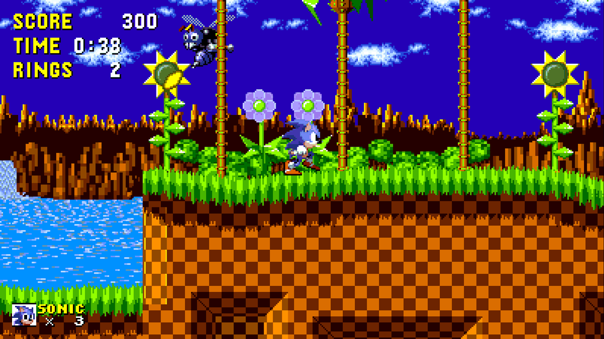
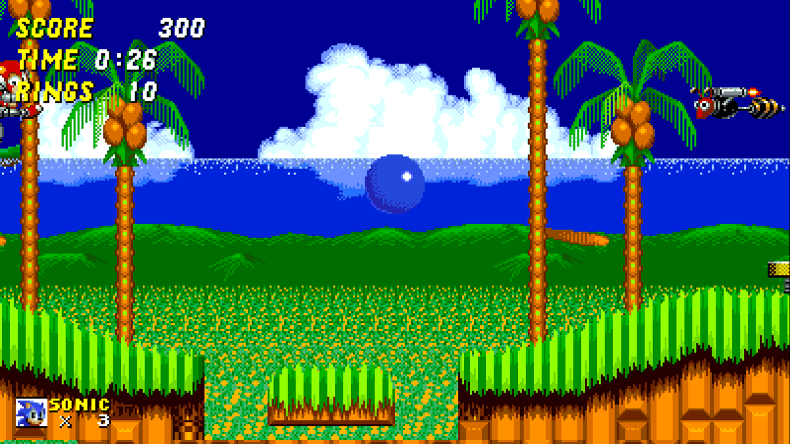
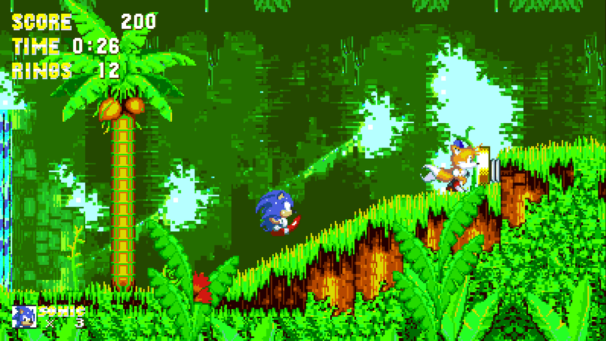
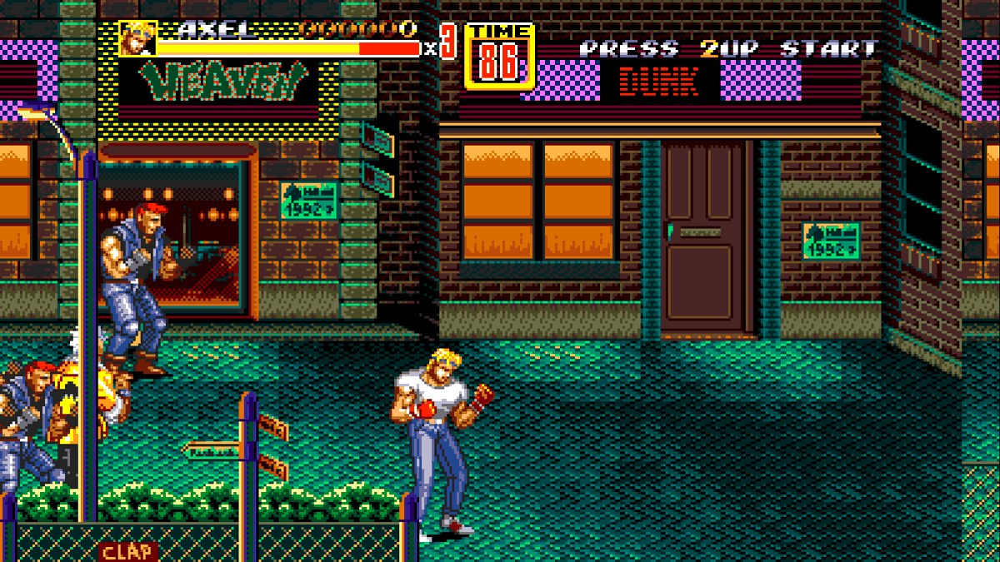
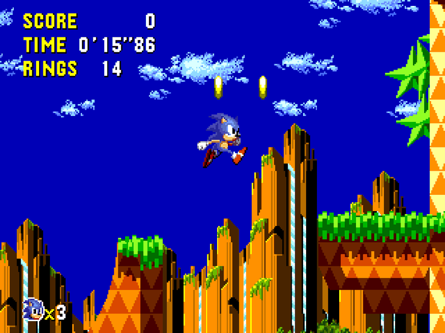
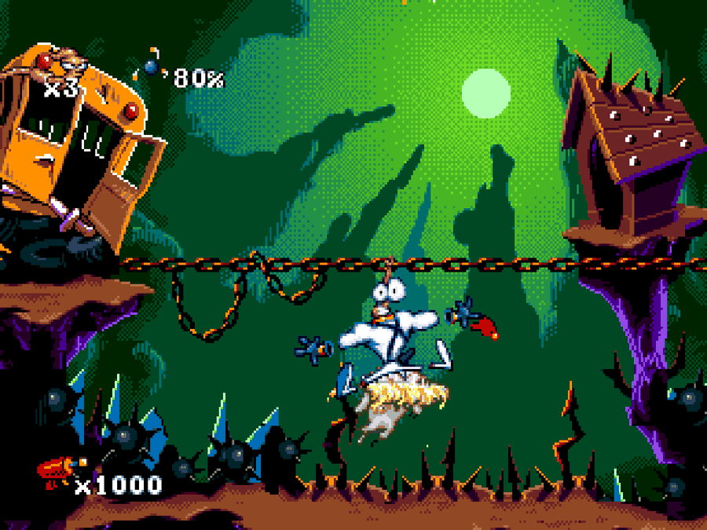
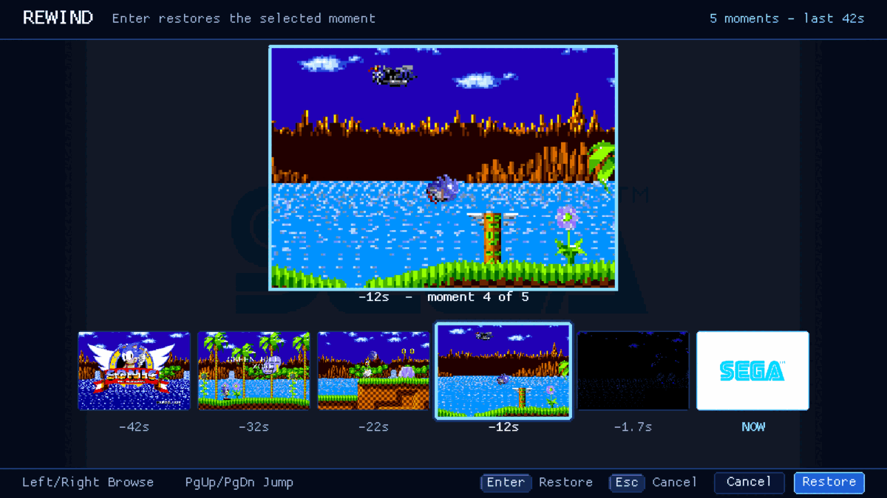

# segarecomp

**Experimental static recompilation for Sega consoles.**

segarecomp explores a way to run Sega console software on modern computers without
interpreting the original CPU instructions while the program runs. It discovers and
translates supported instructions **ahead of time** into portable C11, then compiles
that C and links it with a native implementation of the console's hardware.

This is an open-source engineering project **and an experimental launcher**, not yet
a general-purpose replacement for a Sega emulator. Unsupported code or behavior
is reported explicitly rather than silently treated as working.

## How it works

```text
ROM / disc image
      |
      v
Image model -> static decode, lift and code discovery
      |
      v
Generated portable C11 -> native compilation
      |
      v
Generated-native program + console hardware runtime
```

The CPU code in a generated program is statically compiled: **no interpreter, no JIT,
no runtime target-opcode decoder, and no runtime code generation**. Runtime state
may select only among code generated and compiled from build-time inputs.
The runtime supplies machine behavior such as memory, devices and video. CPU-specific
semantics and machine/device behavior remain separate, so the same foundations can
be reused across platforms without assuming their hardware is identical.

For the detailed pipeline, see [the architecture overview](docs/architecture/pipeline.md).

## Project status

segarecomp runs commercial **Genesis / Mega Drive** and **Master System** games, and, experimentally, **Sega CD** games from your own BIOS and disc. Compatibility is not universal: games not listed
below may reach gameplay, stop at unsupported behavior or fail to build.

**What is in which place.** The latest published release is **v0.7.0** (2026-11-01). Items marked **(main only)** were merged afterwards and are in the source tree and the next release, not in the v0.7.0 archives.
Per-game evidence and per-feature availability are in the [compatibility ledger](docs/product/compatibility-ledger.md) ([JSON](docs/product/compatibility-ledger.json)); release notes are in the [changelog](CHANGELOG.md).

| Target | What exists today | Important limits |
| --- | --- | --- |
| **Genesis / Mega Drive** | Generated-native MC68000 **and Z80**, Genesis runtime, VDP, YM2612/PSG audio, SDL3 viewer, launcher library. Two three-button pads. Compatibility and Optimized build modes. Opt-in static-first Z80 image production in the CLI, `--z80-static 1` **(main only)**, not a guarantee for any title. | No six-button pad. Execution is 60 Hz even for the Europe region. Compatibility is incomplete for titles not listed here. |
| **Master System** | Generated-native Z80, C11 runtime, VDP, PSG, controllers with the console Pause button, mapper support (declared explicitly), optional viewer with input recording (`--viewer-record`), launcher library. | The cartridge mapper is declared by you or a sidecar file, never guessed. Compatibility varies by title. |
| **Sega CD** (experimental) | Authentic BIOS execution (your own BIOS) on generated-native Main and Sub MC68000 plus the main-side Z80; CD-DA, RF5C164 PCM, FM and PSG mixed in the viewer; **persistent internal backup RAM**; launcher import (BIOS + CUE), automatic build (Compatibility or File-first) or a verified prebuilt program; input recording and exact replay. | **Complete CUE-to-play compilation is not claimed.** Code that is generated, decompressed or reached only through input the build never saw stops with a typed stop. FM/PSG output is not reference-checked and the mix level against CD-DA/PCM is not established. No six-button pads or player 2 in the Sega CD viewer. BIOS, disc and programs are yours and never bundled. |
| **Game Gear** | Planned. | No implementation and no compatibility claim. |
| **32X / Saturn** | Roadmap targets. | No implementation and no compatibility claim. |

All three implemented targets run CPU code that was **statically compiled to C ahead of time**. There is no interpreter, JIT or runtime opcode decoder.

### Known working games

These are games that were actually run through segarecomp. The **kind of evidence matters**, so each is labelled. "Maintainer-reported" means the maintainer played it and reports the result; it is
**not** an independently replayed or automated validation, and no session recording is published. Build mode and exact image revision of those runs were not recorded.

| Platform | Game | Outcome | Evidence |
| --- | --- | --- | --- |
| Genesis | Sonic the Hedgehog | completed (beatable start to finish) | maintainer-reported |
| Genesis | Sonic the Hedgehog 2, Sonic the Hedgehog 3, Streets of Rage, Streets of Rage 3 | fully playable (completion not claimed) | maintainer-reported |
| Master System | Sonic the Hedgehog, Sonic the Hedgehog 2, Wonder Boy III: The Dragon's Trap, Alex Kidd in Miracle World | run well (completion not claimed) | maintainer-reported |
| Sega CD | Sonic CD (USA) | completed, **including the special stages** | maintainer-reported; in addition its boot, title, START presses, first level, timed input, special-stage attract demo and intro are checked frame for frame against an independent reference at pre-registered checkpoints |
| Sega CD | Earthworm Jim Special Edition | completed | maintainer-reported; in addition a deterministic scripted START-then-RIGHT route of 20,000 frames runs without a stop (no reference emulator was available) |

Many more Genesis titles reach gameplay; they are not claimed here. These examples do not imply universal compatibility across games, revisions or regions. See the
[platform documentation](platforms/README.md), the [ledger](docs/product/compatibility-ledger.md) for what is unknown or untested, and
[Sega CD play](docs/product/sega-cd-play.md).

## Native widescreen and game patches **(main only)**

Everything in this section is merged after v0.7.0 and ships with the next release.

* **Generic widescreen.** In the pause menu, **Widescreen Mode** is *Original*, *Extended Backgrounds* (Level 2: real background scenery beside the picture) or *Enhanced Widescreen* (Level 3: the
  sprites the game already places beside it). **Widescreen Width** goes from 4:3 to 16:9; **Side Presentation** is *Comfort*, *Borders* or *Raw Extension*. Settings are per game and apply live.
  Support is reported honestly, often as **Partial**. On Master System the extra columns only repeat scenery already on screen, and Level 3 does not make a game create objects outside its original window.
* **Game patches (`.segapatch`, Genesis).** *Schema 1* is a verified data-only BPS delta. *Schema 2* adds a **trusted native C11 provider** written against a small public SDK, which can reconstruct scenery from the
  game's own level data and redraw its original HUD at the widened picture's edge. A patch creates a separate **Patched** variant beside **Vanilla**, bound to one exact game image and to the exact package you approved.
* **Game-specific work stays out of the engine.** Packages for Sonic 1, Sonic 2, Sonic 3 & Knuckles and Streets of Rage 2 are maintained in the separate [segarecomp-patches](https://github.com/marinocg/segarecomp-patches) repository, the destination for their source, documentation and `.segapatch` releases; they are **not shipped with segarecomp releases**. The maintainer states their extended scenery and
  widescreen were validated in all levels (see the [ledger](docs/product/compatibility-ledger.json)); gameplay-affecting packages say so. Capabilities depend on the exact game, revision and package.
* **Security.** A schema 2 patch is **executable code and is not sandboxed**. A hash proves the file is unchanged, not who wrote it or that it is safe. Install native patches only from sources you trust.

<table>
<tr>
<td width="50%"><br><sub><b>Sonic the Hedgehog</b>: authored scenery and relocated HUD (private patch package).</sub></td>
<td width="50%"><br><sub><b>Sonic the Hedgehog 2</b>: scenery, relocated HUD and an actor in the extended margin (gameplay-affecting patch).</sub></td>
</tr>
<tr>
<td width="50%"><br><sub><b>Sonic 3 &amp; Knuckles</b>: authored foreground, partly wrapped background, relocated HUD (gameplay-affecting patch).</sub></td>
<td width="50%"><br><sub><b>Streets of Rage 2</b>: extra sprites beside the picture from a data-only patch plus generic Level 3; no authored scenery or HUD.</sub></td>
</tr>
<tr>
<td width="50%"><br><sub><b>Sonic CD</b> (Sega CD, from your own BIOS and disc): original 4:3. No widescreen patch exists yet.</sub></td>
<td width="50%"><br><sub><b>Earthworm Jim Special Edition</b> (Sega CD): original 4:3. No widescreen patch exists yet.</sub></td>
</tr>
</table>

The four Genesis frames are real frames from generated-native programs (Enhanced Widescreen, 16:9, Raw Extension, first scenes shown); the two Sega CD frames are the original 4:3 picture (generic Sega CD widescreen is always Partial and no game-specific patch exists). Details and attribution in the [showcase notes](docs/assets/showcase/README.md). The patch packages are
not bundled with any release, results depend on the exact game, revision and package, and native-code patches must come from trusted sources. Game artwork belongs to its owners.

More: [widescreen and patches overview](docs/product/widescreen-and-patches.md), [patch packages](docs/product/patch-packages.md), [native patch SDK](docs/product/native-patch-sdk.md).

## Save states and rewind **(main only; Genesis, Master System, Sega CD)**



*The rewind screen on a widescreen-patched Sonic the Hedgehog (maintainer-authorized showcase image; see [docs/assets/showcase/README.md](docs/assets/showcase/README.md)).*

* **Game saves just work.** A cartridge's own battery memory (SRAM, or the 128-byte EEPROM some cartridges use) is stored automatically when you end the session yourself, per game and per patched version, in your library folder.
* **Save states.** *Save State* / *Load State* in the pause menu give you five numbered slots, each with the picture and play time of the moment it holds; **F5** / **F8** use a quick slot. A state is the whole machine, sound chips included: loading it
  continues exactly where you left off. A failed save never damages the old state and a failed load never changes the running game.
* **Rewind (F7).** The game keeps a moment every half second for the last minute (about 120 moments, in memory only), so you can undo a mistake. Open the rewind screen, browse the pictures on the timeline with the arrow keys, the D-pad or the mouse, pick one and play on from there;
  cancelling changes nothing. The pause menu's *Rewind* row and holding both gamepad triggers open it too.
* The same states and rewind work on **Master System** (cartridge RAM is in every state but not saved between sessions) and **Sega CD** (a state is bound to the disc, the BIOS and the program's image set; loading one changes only the backup RAM in memory, and about 43 seconds fit in the default 96 MiB). Everything, including where the files live, what is guaranteed and measured costs, is in [docs/product/save-states.md](docs/product/save-states.md).

## Download and try segarecomp

The [Releases](../../releases) page provides experimental desktop launcher archives
for Windows (`segarecomp-<version>-windows-x86_64.zip`), Linux
(`-linux-x86_64.tar.gz`), and Apple Silicon macOS (`-macos-arm64.zip`).
Check the downloaded archive against `SHA256SUMS.txt`.

### From a game image you own to playing

1. Extract the archive and open **Segarecomp** (`Segarecomp.exe`, `Segarecomp.app` or `./Segarecomp`, depending on your platform).
2. Drop your ROM into the window or select **Browse...** (Genesis `.md/.bin/.gen/.smd` and Master System `.sms`, or a `.zip` holding exactly one). For Sega CD use **Import ROMs > Add Sega CD game...** with your BIOS image and the disc's CUE file.
3. Open the game and choose the build settings below, then **Recompile & Play** (for Sega CD, **Build**, then **Play**). The first build can take several minutes (a Sega CD disc, much longer); cached builds start immediately.
4. Play. **Esc** (or the gamepad's Back button) opens the pause menu: Save State, Load State, Rewind, Quick Settings, Video & Display, Controls, Audio, System. Closing the window returns to the launcher.
   On Genesis your game's own saves (SRAM / EEPROM) are kept automatically when you quit; on Genesis, Master System and Sega CD you can save and load whole-machine states (**F5** / **F8** for the quick slot, five numbered slots in the menu) and
   **rewind** (**F7**) through the last minute of play (about 43 seconds on Sega CD): see [docs/product/save-states.md](docs/product/save-states.md).
   Master System games need their cartridge mapper declared on the game's page.

### Install a verified patch **(main only; Genesis)**

1. Open the game's **Details** page and find the **Patches / Variants** card, then **Install patch...** and choose the `.segapatch` file.
2. The package is verified against the game's exact image; a package for another game or revision is refused. For a native (schema 2) patch, read the sheet: author, license, source digest and "contains executable source, not sandboxed". **Approve only a patch you trust.**
3. Select **Patched**, then **Build patched version**, then **Play Patched**. **Vanilla** stays untouched and playable. **Remove patch** returns to Vanilla and keeps your saves, recordings and settings.

**Recommended first try (based on maintainer testing):**

- **Genesis / Mega Drive:** **Optimized** is the launcher's default **Build
  mode** for new games (it uses the model that earlier versions offered as
  *Experimental model*; there is no separate checkbox any more). It has worked
  well in the maintainer's game tests. For headless builds, the corresponding
  options are `--aot-policy optimized --aot-model gen2`.
- **Master System:** **Optimized** is also the default when the launcher's
  bundled product offers it (otherwise the game builds as Compatibility). This
  mode is still experimental. For headless builds, use `--aot-policy optimized`.
- **Sega CD:** **Compatibility** is the long-established default; **File-first (structural)** compiles more of the disc ahead of time and helps when a title stops at an uncompiled entry after a menu choice.

**Compatibility** is an explicit choice under **Build mode** and remains the
conservative fallback if an optimized build fails or a game behaves incorrectly.
The `segarecomp build` command-line default is unchanged (Compatibility). An Optimized
request can also fall back to Compatibility automatically; Master System may
restart in Compatibility for its supported unadmitted-code stop. These are
recommendations for what to try first, not guarantees for every game.

The packages include the compiler (a pinned Zig toolchain, used to compile generated
C) and SDL3. **No ROMs, BIOS files or disc images are included**; use only software you are legally entitled
to analyze. These are experimental builds: the launcher recognizes Genesis/Mega
Drive and Master System images, plus Sega CD from your own BIOS and CUE. Several games already work well (see
[Known working games](#known-working-games)), while others may reach gameplay,
stop at unsupported behavior or fail to build.
An image without compatibility metadata may be labelled **Compatibility unknown**;
**Try anyway** is not a promise that it works.

### Launcher controls and useful options

- **Controls:** by default arrow keys, Z/X/C for A/B/C and Return for Start (Genesis); Master System uses Z/X for buttons 1/2 and P for the console Pause. **Keys and gamepad buttons can be remapped** on the pause
  menu's **Controls** page (Player 1 and Player 2, fresh-press capture, duplicate-owner warning, restore defaults), and the menu key is rebindable (Esc always works). Genesis is a **three-button** pad; there is no
  six-button X/Y/Z/Mode input. Other in-game keys: **F11** fullscreen, **F12** saves a PNG of the **game picture** (source pixels, not the effects or the widescreen extension) to `Pictures/Segarecomp`,
  **F5** / **F8** quick save / quick load and **F7** rewind (Genesis, Master System, Sega CD; the Sega CD frame step is **F9**), **F3** cycles the performance overlay **(main only)**. Audio volume and mute are on the Audio page; the output device follows the OS. Controller trouble: Settings > Input Diagnostics.
- **Recording and replay:** Sega CD sessions can be recorded and replayed exactly from the game's details page; the Master System viewer records with `--viewer-record`. The Genesis viewer has no input recording.
- **Sega CD saves:** the internal backup RAM persists between sessions as protected user data that cleanup, rebuilds and removing the game never delete.
- **Genesis region:** USA NTSC, Japan NTSC or Europe PAL. This currently changes
  the version register only; execution remains **60 Hz** even when Europe is
  selected, and the launcher indicates that 50 Hz is unsupported. The default
  follows the ROM header (a lone `E` is ambiguous and retains USA). The choice is
  applied at launch via `SEGARECOMP_GENESIS_REGION` without rebuilding. Headless:
  `--run --region <usa|japan|europe>`.
- **Advanced Genesis HInt alias discovery:** the optional, default-off
  **HInt alias discovery (strict build pass)** toggle applies a strict
  H-interrupt policy during build-time preparation. It can resolve a
  RAM-resident IRQ4 vector through the ADR 0049 copy-alias/RAM-thunk preparation.
  Because it changes generated code, it has a separate cache entry.
  Headless: `--hint-alias-discovery`.
- **Static-first Z80 image production (CLI, opt-in):** `segarecomp build --z80-static 1`
  reconstructs the Genesis sound-driver images that are provable from the
  cartridge alone (ROM copies and the recognised Kosinski loader) before the
  first Z80 compilation. The build-time verification run must agree, otherwise
  the unchanged discovery fixed point runs; the output is identical either way.
  See [ADR 0277](docs/decisions/0277-seg-128-genesis-z80-static-first-image-production.md).
- **Native GEMS audio replacement (CLI and launcher, opt-in, experimental, Genesis):** `segarecomp build --sound-driver gems`
  replaces one verified sound driver (GEMS 2.5, uploaded by several games whose
  original Z80 driver rewrites its own code and is therefore silent on the original
  path) with a native C11 re-implementation of its behaviour - music and effects;
  it is never a Z80 emulator and is refused for any unverified driver. It is
  compared operation by operation with an independent reference implementation
  (docs/testing/genesis-native-gems-validation.md). The build records which audio
  implementation the executable has and the launcher shows it in Build provenance.
  See [ADR 0291](docs/decisions/0291-genesis-native-gems-sound-replacement.md).
- **Master System mapper:** mapper identity must be explicitly selected or
  supplied through the supported sidecar/manifest route; it is not guessed.
  See [Master System details](platforms/master-system/README.md).
- **Build cache and diagnostics:** generated builds live in
  `%LOCALAPPDATA%\Segarecomp\` (Windows),
  `~/Library/Application Support/Segarecomp/` (macOS) or
  `~/.local/share/Segarecomp/` (Linux). Directly selected ROM files are
  referenced rather than copied; library ZIP imports can extract their ROM
  into the managed library. On failure, **View diagnostics** shows the log,
  also saved as `build.log` under `games/<id>.failed/`, which is useful for
  bug reports.
- **macOS:** current packages are not notarized. Gatekeeper may require
  right-clicking the app and choosing **Open** the first time (the original
  workaround is `xattr -dr com.apple.quarantine Segarecomp.app`).
- **Linux:** release archives require glibc 2.35 or newer.
- **Third-party components:** bundled Zig, SDL3, Dear ImGui and other shipped
  dependencies have notices in the package's `licenses/` directory.

To build the launcher and distribution archives from source, see
[packaging/README.md](packaging/README.md). The developer build below is separate.

## Repository map

| Path | Contents |
| --- | --- |
| `libs/` | reusable libraries: core, MC68000 and Z80 CPU semantics, recompiler, C11 code generation, devices and media |
| `platforms/` | machine/runtime/viewer composition for Genesis, Master System and Sega CD (synthetic and authentic-BIOS); other targets have roadmap documentation |
| `apps/segarecomp` | the CLI (including `build`, the native ROM-to-executable route) |
| `apps/segarecomp-launcher` | opt-in consumer GUI launcher (SDL3 + Dear ImGui) |
| `packaging/` | release staging, package smoke test, pinned third-party inputs |
| `tools/` | Python developer tools (startup bridge, frontier debugging, Ghidra, baselines) |
| `tests/` | tests; the root `CMakeLists.txt` only orchestrates |
| `docs/` | architecture, decisions (ADRs), references, testing policy |

Further reading: [CONTRIBUTING.md](CONTRIBUTING.md), [platforms](platforms/README.md),
[pipeline](docs/architecture/pipeline.md).

## Build from source (developers)

### Quick start (all hosts)

Requirements: CMake >= 3.25, Ninja, Python >= 3.10, a C/C++ toolchain (see "Supported hosts").
Commands below use `python3` (macOS/Linux); on Windows use `python` or `py -3`.

```sh
cmake --workflow --preset dev-build   # configure + build
cmake --workflow --preset dev-fast    # + fast tests   (dev-full: full hermetic suite)
python3 -c "open('build/quickstart.bin','wb').write(bytes.fromhex('4AB9 00A1 0008 4E70'))"
python3 tools/genesis_startup_bridge.py --rom build/quickstart.bin --entry 00000B00 --mode synthetic --out-dir build/quickstart
```

The second-to-last line writes a tiny project-authored synthetic image (it stops at an unsupported
instruction; that sanitized JSON stop is the expected result). The bridge finds
`build/dev/apps/segarecomp/segarecomp` (`.exe` on Windows) and a C compiler (`$CC`, else
`cc`/`clang`/`gcc` on PATH) automatically; pass `--segarecomp`/`--cc` explicitly for reproducibility.
For the optional authorized-local Genesis viewer add `--viewer` (needs SDL3; see below and
`docs/development/genesis-viewer.md`; the tool fails clearly if SDL3 is missing).
`python3 tools/genesis_startup_bridge.py --help` lists examples. No canonical command needs `xcrun`.

### Supported hosts

`.github/workflows/ci.yml` builds and tests every change on all three hosts (configure with the
`dev` preset, build, then one cost-balanced shard of the hermetic suite per matrix job: six shards per host, labelled
`shard-1`..`shard-6` by `tests/ci_shards.cmake`, whose union is the `full` tier that contains `fast`; run one locally with
`ctest --preset dev -L '^shard-3$'`, and the whole partition is checked by `ci_shard_guard_test`); Ninja is the generator everywhere.

| Host | Primary toolchain (CI-tested) | Generated-C compiler (`$CC`) |
| --- | --- | --- |
| macOS | AppleClang + Ninja (`brew install ninja`) | `cc` (`xcrun --find cc` optional) |
| Linux | GCC 13 + Ninja (Ubuntu 24.04: `apt install cmake ninja-build g++`) | `/usr/bin/cc` |
| Windows | LLVM/Clang + Ninja inside a Visual Studio developer prompt (`CC=clang CXX=clang++`) | `clang` |

MSVC `cl` is not yet supported (not tested). On Windows, Python runs in UTF-8 mode under CTest, and
the private full/ephemeral report pipes pass a native inherited HANDLE that the generated child
converts to its own CRT fd. The ordinary `full` gate has the same product/generated-execution
surface on all three hosts; the developer measurement test `genesis_experiment_aligned_aot_report_failure_test`
(built on POSIX `getrusage`) is in the `extended` tier. Local commercial inputs, Ghidra, and
Docker tests are never part of the CI matrix.

Optional SDL3 viewer: install SDL3 development files (`vcpkg install sdl3` on every host (Linux needs `autoconf autoconf-archive automake libtool libltdl-dev` plus
the X11/Wayland/audio dev packages listed in the CI job; macOS may alternatively use `brew install sdl3`)), then configure with `-DSEGARECOMP_ENABLE_SDL3_VIEWER=ON` (plus
`-DCMAKE_TOOLCHAIN_FILE=<vcpkg>/scripts/buildsystems/vcpkg.cmake` when using vcpkg) and build the
`segarecomp_viewer_genesis_sdl3` target. CI compiles it on all three hosts.

### General-startup bridge

The bounded generated-native bridge has one project-owned compile/run entry point:

```sh
python3 tools/genesis_startup_bridge.py --segarecomp build/dev/apps/segarecomp/segarecomp --cc "$CC" \
  --rom synthetic.bin --entry 00000B00 --mode synthetic
```

`$CC` is the host's strict-C11-capable C compiler (see "Supported hosts"). The generated program
reports privately through an inherited writer, never a file: on POSIX an inherited file descriptor;
on Windows an explicitly inherited native HANDLE (only the requested handles are listed to the
child) that the generated program converts in the child with `_open_osfhandle` + `_fdopen`. Nothing
private is persisted, and the same bridge tests run on Windows as on the other hosts.

It writes generated C and its executable only to a Git-ignored output directory, compiles with
strict C11 flags, and prints a sanitized JSON result. `--compare-runs` runs the same generated
binary twice and reports whether its results match. Commercial mode never accepts a full-report path.

### Architecture and contribution guide

The recompilation pipeline is intentionally deterministic and fail-closed:
unsupported instructions or unresolved executable paths must not turn into
silent no-ops. CPU-specific semantics belong to their CPU implementations;
machine/device behavior lives in the appropriate runtime and device libraries.
The aim is reusable foundations, not a speculative universal CPU abstraction.

For the complete design and validation contracts, see
[the pipeline documentation](docs/architecture/pipeline.md) and
[CONTRIBUTING.md](CONTRIBUTING.md) before making changes.

### Optional Ghidra debugging

**Ghidra is optional developer tooling for debugging and investigating
recompilation issues. It is not required to build segarecomp, recompile a game,
or launch and play games.** Normal game execution does not use Ghidra.

For developers investigating code discovery or other tricky failures, a pinned,
containerized headless Ghidra and Ghidra MCP bridge are available through
`python3 tools/ghidra.py`. See
[docs/testing/ghidra-analysis.md](docs/testing/ghidra-analysis.md).
No ROMs or host directories are mounted unless explicitly placed in the
ignored input directory.

## Legal and ROM policy

No commercial ROMs, firmware, keys, or vendor SDK material are distributed.
Bring only software you are legally entitled to analyze. Local commercial
images belong in the fully ignored `games/` directory; tests and CI use
project-authored synthetic inputs. See
[the commercial-game testing policy](docs/testing/commercial-games.md).

## License and third-party notices

segarecomp's own code is licensed under the
[Mozilla Public License 2.0](LICENSE). Third-party components retain their
respective licenses: for example, the repository includes vendored `ymfm`
code for YM2612 support under the BSD 3-Clause License. Consult the
upstream license in `libs/device/sega/ym2612/third_party/ymfm/` and
[packaging/README.md](packaging/README.md) for distribution details.

Release packages also redistribute components including SDL3 (zlib), Zig
(MIT, the bundled C compiler) and Dear ImGui (MIT); applicable notices ship
in their `licenses/` directory. No security-reporting contact policy has been
established yet, so there is no `SECURITY.md`.
